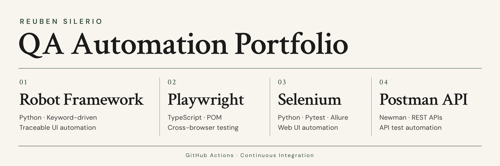

# Reuben Silerio
**QA Engineer · Web & Mobile Testing · UI & API Automation**

I turn requirements into test scenarios, investigate defects, and help teams make informed release decisions. My professional background spans functional, regression, exploratory, UAT, and production testing across web, Android, iOS, and mobile web.

At work I build and maintain **Robot Framework** test automation. My public portfolio brings the same testing experience into **Playwright + TypeScript**, **Selenium + Python**, and **Postman + Newman**, with automated execution through **GitHub Actions**. I also test AI chatbots and use AI tools in my own manual and automation workflow.

[Current work](#current-work--robot-framework-automation) · [Explore projects](#featured-projects) · [CI and reporting](#ci-and-reporting) · [Live Allure report](https://siler1o.github.io/selenium-qa-automation-portfolio/) · [Test-case tracker](https://docs.google.com/spreadsheets/d/1E-rbgsHj4jv7pamglMdsREiQnfcl-aHWACqrRmAwD3w/edit?usp=drivesdk)

| Test design | Team coordination | Platform coverage |
| :--- | :--- | :--- |
| **400+ test cases maintained** | **6-person QA team** | **Web · Android · iOS · Mobile web** |

## Automation toolkit

## Current work · Robot Framework automation

**Building a company's Robot Framework UI automation from the ground up, alongside manual testing and test documentation.**

- Layered framework structure: a shared resource hub, feature keyword files for test steps, Python page files for locators, and separate input files for test data.
- Every automated test case ID matches its test case in the team's test management tool, so automation results trace straight back to documented cases.
- Each test has its own setup and teardown, so cases run independently and in any order.
- Clean, consistently aligned keyword tables with descriptive variable names, following the team's coding standards and code review.
- Write and maintain test cases, test runs, and bug tickets in an internal test management tool: exact expected results, concrete input values, and clear preconditions.

*Company code is private, so this work isn't linked here.*

## AI and LLM testing

- Test AI chatbots for hallucinations, factual drift, and quality degradation in long conversations and large contexts.
- Use AI tools day to day to speed up test design, test data, debugging, and automation code, and review their output like any other code.

## Featured projects

### 01 / Playwright · TypeScript · Cross-browser testing

**UI automation suite for the QA Playground practice site: all 18 designed scenarios automated, each run on Chromium, Firefox, and WebKit.**

- Drives the site like a user: typing, clicking, selecting, searching, sorting, paginating, submitting forms, uploading files, dragging cards, and switching between tabs and iFrames, with every scenario documented step by step in a test-case tracker.
- Verifies outcomes through visible results: field values, result messages, validation errors, enabled and disabled states, selected options, row counts, sort order, and link HTTP status.
- Reusable page objects with role- and test-id-based locators, and retrying assertions instead of fixed waits.
- Handles real-site timing: bounded waits for changing UI, and a retry on the first action when a page has not finished hydrating.
- Named `test.step()` blocks map each check to its tracker step in the HTML report.
- GitHub Actions runs the suite on pushes and PRs, retries failures, and retains HTML reports for investigation.
- Coverage (18 of 18): input fields, buttons, forms, dropdowns, data table, alerts and dialogs, radio and checkbox, date picker, links, tabs and windows, dynamic waits, multi select, file upload, drag and drop, iFrames, Shadow DOM, modal windows, and infinite scroll.

[**View project →**](https://github.com/siler1o/QA-Playwright-TypeScript-Automation) · [Excel tracker](https://github.com/siler1o/QA-Playwright-TypeScript-Automation/blob/main/test-cases/QA_Playground_TypeScript_Playwright_Test_Suite.xlsx) · [CI runs](https://github.com/siler1o/QA-Playwright-TypeScript-Automation/actions)

### 02 / Selenium · Python · UI regression

**26 planned UI scenarios implemented for Automation Exercise.**

- Registration, authentication, product discovery, cart operations, checkout journeys, reviews, invoice downloads, and scrolling.
- Reusable page objects, explicit waits, shared Pytest fixtures, and isolated registration data.
- Headless Chrome execution in GitHub Actions, with Allure results retained as artifacts.
- Successful eligible `main` runs generate and publish the Allure report to GitHub Pages.

[**View project →**](https://github.com/siler1o/selenium-qa-automation-portfolio) · [Live Allure report](https://siler1o.github.io/selenium-qa-automation-portfolio/) · [CI/CD workflow](https://github.com/siler1o/selenium-qa-automation-portfolio/blob/main/.github/workflows/selenium-ci.yml)

### 03 / Postman · Newman · API automation

**14 positive and negative scenarios against the Automation Exercise practice API.**

- GET, POST, PUT, and DELETE coverage for products, brands, search, login, and account lifecycle operations.
- JavaScript assertions distinguish HTTP status from the API's JSON `responseCode`, then validate structure and values.
- Generated test accounts support create → login → update → retrieve → delete flows, including login rejection after deletion.
- Newman runs the collection in GitHub Actions and preserves JUnit results for 14 days.
- Dependency guards block account operations when successful account creation has not been recorded.

[**View project →**](https://github.com/siler1o/postman-api-testing-portfolio) · [Collection & environment](https://github.com/siler1o/postman-api-testing-portfolio/tree/main/postman) · [CI runs](https://github.com/siler1o/postman-api-testing-portfolio/actions/workflows/api-tests.yml)

## CI and reporting

| Project | Automated execution | Evidence | Delivery |
| :--- | :--- | :--- | :--- |
| Playwright | Pushes and PRs to `main`; manual runs | HTML report; trace on first retry | Downloadable report artifact |
| Selenium / Pytest | Pushes and PRs to `main`; manual runs | Allure results and published report | Allure report deployed to GitHub Pages after successful eligible runs |
| Postman / Newman | Relevant pushes to `main`; PRs to `main`; manual runs | CLI output and JUnit artifact | Downloadable test results |

**CI is implemented in all three projects.** Selenium also demonstrates automated report deployment. These portfolios do not deploy the applications under test.

The badges link to current workflow results. Public practice-site availability can affect runs; a published report may represent an earlier successful execution.

## What I bring to a QA team

- **Requirements analysis:** convert expected behavior into functional, negative, and edge-case coverage.
- **Release verification:** smoke, regression, exploratory, QAT, UAT, and blue-green deployment checks.
- **Defect investigation:** clear reproduction steps, severity and business-impact assessment, fix verification, and follow-through.
- **QA coordination:** assign testing activities, track progress and blockers, and communicate release risks.
- **Practical automation:** maintainable page objects, meaningful assertions, reproducible test data, and CI evidence.

## Current focus

Growing a Robot Framework suite at work, keeping automation traceable to documented test cases, and improving test reliability and failure diagnostics across my UI and API projects.

**Based in the Philippines · Always happy to connect with QA and automation teams.**

## Contact

Get in touch:

[GitHub projects](https://github.com/siler1o?tab=repositories)
